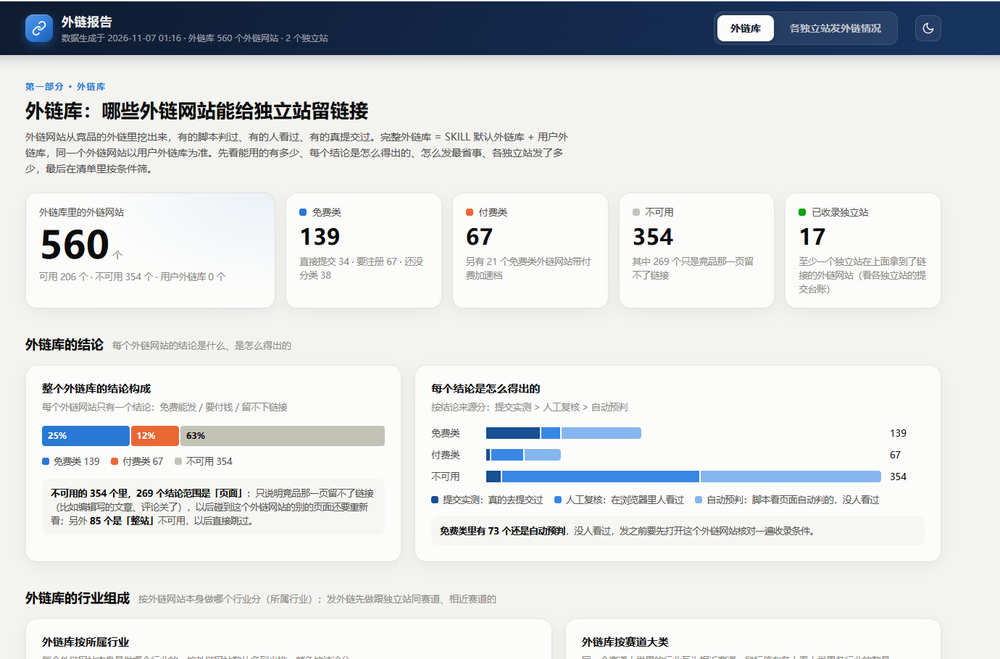

# seo-ai-link v0.91 更新日期：1107

[](VERSION)
[](LICENSE)

竞品外链挖掘 → 外链库管理 → AI 自动发外链 → 收录回访，全流程配有可视化报表



## seo-ai-link 是什么

seo-ai-link 是一套覆盖独立站外链全流程的 Skill。安装到 Claude Code、Codex、WorkBuddy、豆包电脑版等支持 Skills 的 AI 工具后，在对话中直接使用

包含五个环节，依次衔接：

- **竞品外链挖掘**：通过 DataForSEO 获取竞品网站的外链（也可换用其他外链数据工具，由用户决定），脚本自动预判每个外链网站的可用性；无法自动判定的，由 AI 在浏览器中逐个复核
- **外链库**：每个外链网站按多个维度管理：可用性（免费 / 付费 / 不可用）、提交方式（直接提交 / 注册账号提交）、站点类型（导航与产品发布 / 社区论坛 / 自建内容 / 需回链或徽章）、所属行业、链接属性（dofollow / nofollow）、域名权重、结论来源（提交实测 / 人工复核 / 自动预判）。内置作者核对过的外链网站
- **AI 自动发外链**：按免费或付费、链接属性、与独立站的行业相关度分档排序，由 AI 完成注册登录、填写表单和提交。涉及付费、行业不相关，或要求在独立站放置回链、徽章的外链网站，先经用户确认再提交
- **收录回访**：每个独立站一份提交台账，记录在每个外链网站上的提交状态。提交后次日起每日回访，核查是否收录
- **可视化报表**：本机 HTML 报表，分「外链库」和「各独立站发外链情况」两部分，展示可用外链网站的数量与构成、提交与收录进度、待发外链的优先顺序，支持按行业等条件筛选

## 发外链原则

seo-ai-link 不提供批量群发、链接农场（Link Farm）、站群（PBN）、无头浏览器高速批量提交这类做法：这类外链容易被搜索引擎识别为垃圾外链，对独立站意义不大

**AI 以安全、合理的方式代用户提交，并按每个外链网站的要求自适应调整：**

- 在有界面的独立 Chrome 窗口中逐个打开、填写、提交，每个独立站每天最多成功提交 10 个
- 提交前先核对收录条件（产品类型、免费档、语言、地区、收入数据等），独立站不符合的跳过并记录原因
- 按外链网站支持的方式提交：免登录表单、邮件、注册账号、个人资料网站栏、自建内容
- 表单内容按外链网站的要求调整：介绍字数不够时按独立站的实际内容补写；所需信息先自行查找，查不到才问用户，不编造
- 登录前核对账号属于当前独立站，每个独立站使用专用邮箱和一次性密码
- 以提交接口的返回或成功页判断是否提交成功，不以表单清空为准
- 遇到人机验证不绕过，交给用户完成

**外链实践中不做的方式：**

- 博客评论群发：竞品链接写在文章正文里的，评论框不算提交入口；与独立站无关的文章不留言；评论者名字只链到平台个人主页的，留不下外链
- 镜像站、转载站发帖：自动搬运的镜像帖、转载站内容无人浏览，链接多为 nofollow
- 提交从未被合并过的 PR：例如外人 PR 从未被采纳的 awesome 清单
- 需要安装第三方 App、浏览器插件或命令行工具才能提交的
- 需要关注微信公众号、添加站长微信、发朋友圈换取收录的
- 新站默认不做互换链接（在独立站放置对方的回链或徽章），等独立站运营一段时间后由用户决定
- 使用代理、隐身浏览等手段伪装身份

## 内置外链库

当前内置外链库以 AI 产品工具和科技赛道为主。v0.91 共有可用外链网站（免费类 + 付费类）206 个，按所属行业分布如下：

| 所属行业 | 可用 | 其中免费 |
| --- | --- | --- |
| AI 产品工具 | 93 | 58 |
| 计算机、电子与科技 | 30 | 26 |
| 商业与消费者服务 | 28 | 9 |
| 综合导航站（不分行业） | 23 | 19 |
| 综合论坛博客（不分行业） | 18 | 18 |
| 其他（电商与购物、艺术与娱乐、新闻与媒体、求职与职业、金融） | 14 | 9 |

- 综合导航站、综合论坛博客不限行业，任何赛道的独立站都可以提交
- 另有 354 个已核对为不可用的外链网站，其中 85 个整站不可用，挖掘竞品时遇到直接跳过；其余只是竞品那一页留不了链接，遇到同一外链网站的其他页面会重新检查
- 作者会持续更新内置外链库，扩充更多行业赛道。运行 `git pull` 更新 Skill 即可获得最新外链库，用户外链库不受影响

## 用户档案：数据与 Skill 分开存放

Skill 目录只放程序、规则和内置外链库；用户的数据全部存放在用户指定的文件夹（用户目录）中：

- **独立站资料**：每个独立站的名称、介绍、logo，以及发外链专用的邮箱和一次性密码
- **提交台账**：每个独立站在各外链网站上的提交状态和回访记录
- **用户外链库**：用户核对、实测得出的外链网站结论
- **分析结果**：每次挖掘竞品外链的原始数据、复核结论和日志
- **外链报告**：可视化报表

这样做的好处：

- 更新、重装或删除 Skill，数据都不受影响；换电脑或重装系统后，把用户目录拷过去，让 AI 指向它即可继续
- 用户外链库优先于内置外链库，核对过的结论长期沿用：同一个外链网站不重复检查，再挖掘新竞品时直接复用已有结论，节省时间和 DataForSEO 费用
- 多个独立站共用一个外链库，提交台账各自独立
- 用户档案只保存在本机，请定期备份整个用户目录
- AI 在独立的 Chrome 窗口中操作，不会接触用户日常浏览器里的账号、密码和 cookies

## 运行环境与依赖

支持 Windows 和 Mac。AI 工具需要能安装 SKILL.md 格式的 Skill、能添加 MCP，例如 Claude Code、Claude 桌面版、Codex、WorkBuddy、豆包电脑版、MiniMax Code、千问办公、DeepSeek Harness

| 依赖 | 版本 | Windows | Mac |
| --- | --- | --- | --- |
| Python | 3.9 及以上 | 经用户同意后，AI 用 winget 安装 | 从 python.org 下载 .pkg 安装包，自行安装（需输入电脑密码） |
| Python 库 | requests、beautifulsoup4、lxml、python-dotenv | AI 检查环境时自动安装 | AI 检查环境时自动安装 |
| Node.js | 18 及以上 | 经用户同意后，AI 用 winget 安装 | 从 nodejs.org 下载 .pkg 安装包，自行安装 |
| Chrome | 最新版 | 经用户同意后，AI 用 winget 安装 | 从 google.cn/chrome 下载 .dmg 安装包，自行安装 |
| Playwright MCP | 最新版 | AI 添加到所用 AI 工具的 MCP 配置 | AI 添加到所用 AI 工具的 MCP 配置 |

- 官方源连不上时，自动切换国内镜像（pip 用清华镜像，npm 用 npmmirror）
- 习惯手动安装 Python 库的，在 Skill 目录运行 `pip install -r requirements.txt`
- DataForSEO 账号只在挖掘竞品外链时需要，按次计费，每次查询前 AI 会先征得用户同意。新用户注册赠送 1 美元额度，约可查询 15 次

## 快速开始

**第 1 步：安装**

在终端运行：

```bash
git clone https://github.com/chenchaoge/seo-ai-link.git ~/.claude/skills/seo-ai-link
```

以 Claude Code 为例；使用其他 AI 工具时，把 `~/.claude/skills` 换成该工具读取 Skill 的目录

**第 2 步：告诉 AI 任务**

每次从下面四件事里选一件告诉 AI：

- `挖掘竞品网站的外链`
- `整理我的外链库`
- `帮我的独立站发外链`
- `帮我做外链回访`

首次使用时，不管选哪件，AI 都会先检查运行环境、安装缺少的依赖、介绍这个 Skill，再请用户指定一个存放用户档案的文件夹；之后要用到独立站、竞品网址时，AI 会提示用户给出

**第 3 步：在同一个对话中继续**

AI 每次暂停时，最后一行会说明下一步，以及是否需要用户确认，按提示回复即可

## 更新与帮助

```bash
cd ~/.claude/skills/seo-ai-link && git pull
```

[提交问题或建议](https://github.com/chenchaoge/seo-ai-link/issues)

## 关于作者

| | |
|:---|:---|
| 作者 | 陈朝歌chen |
| GitHub | [chenchaoge](https://github.com/chenchaoge) |
| 抖音 | [陈朝歌chen](https://www.douyin.com/user/MS4wLjABAAAAkZOGJtVUaec6vsz1qgF_xnYhgNRvZVoON--_Zl7sGw94dOK2neTeOauA3RYIbD72) |

## 许可证

本项目版权归陈朝歌chen 所有，保留所有权利，完整条款见 [LICENSE](LICENSE)

- 用户可以免费安装和使用这个 Skill，包括给自己的网站做外链、给自己的客户提供外链服务，也可以在自己的设备上修改后自用
- 未经书面许可，不得打包进其他产品、出售或公开发布修改版，也不得用于训练 AI 模型。分享本仓库链接不受限制
